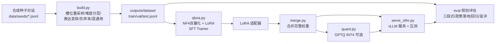

# qlora-forge (toneforge)

**客服话术风格 QLoRA 指令微调流水线**：覆盖 `数据构建 → QLoRA 训练 → 合并/量化 → vLLM 部署 → 评估` 全流程。

> **数据声明**：仓库内全部训练数据（`data/seeds/*.jsonl`、`data/general_samples.jsonl`）
> 均为**演示用合成客服对话**，不含任何真实客户/商家信息。本 README **不公布任何
> 训练效果指标**——冒烟配置只用于验证链路可跑通，实际效果请以下方复现步骤
> 与 `scripts/eval.sh` 的输出为准。

**核心设计**：数据构建、显存估算、评估校验三大纯逻辑模块**只依赖 Python 标准库**——
不装 torch 也能跑通数据流水线与全部单元测试；`transformers / peft / bitsandbytes`
仅在训练、合并、量化脚本内部惰性导入。

## 流水线总览



## 快速开始（Windows / macOS / Linux，无需 GPU）

```bash
git clone <your-fork> && cd qlora-forge
python -m venv .venv && source .venv/bin/activate   # Python 3.12

# 1) 构建指令集：150 条种子 → 900 条（固定 seed 可复现）
python scripts/build_dataset.py

# 2) 显存估算表（纯标准库公式）
python scripts/vram_report.py

# 3) 训练前校验：不下载模型、不装 torch
python -m toneforge.train.qlora --config configs/smoke_qwen05b.json --dry-run

# 4) 全部测试（零第三方依赖）
python -m unittest discover -s tests -v
```

GPU 训练（WSL2/Linux）见 [docs/reproduce_3060.md](docs/reproduce_3060.md)：

```bash
pip install -r requirements.txt
bash scripts/train.sh configs/smoke_qwen05b.json    # RTX 3060 6G 真实可跑
```

7B 生产配置 `configs/prod_qwen7b.json` 估算峰值约 10.1 GB，需 12 GB 以上显存，
参数含义与设计取舍见 [docs/pipeline.md](docs/pipeline.md)。

## 数据规范（摘要）

ShareGPT messages JSONL：`user/assistant` 严格交替、`assistant` 带 `loss` 标记；
客服回复遵循**三段式规范**：`共情 → 政策依据（引用《条款》）→ 下一步动作`。
完整 schema、变体策略、负样本构造见 [docs/pipeline.md](docs/pipeline.md)。

## 显存估算：公式与表格

估算器 `toneforge/train/vram.py`（纯标准库）按分项相加，单位 GB（1GB=1e9B）：

| 分项 | 公式 | QLoRA 取值 |
|---|---|---|
| 权重 | 参数量 × 字节/参数 | NF4 双量化 0.52 B/参数 |
| LoRA 参数 | Σ r×(in+out) × 层数 | r=16、注意力+FFN |
| 梯度 | 可训练参数 × 2 | 仅 LoRA 参数有梯度 |
| 优化器 | 可训练参数 × 12 | AdamW fp32 主权重+双动量 |
| 激活 | B × S × H × L × 2 × C | C=10（梯度检查点开）/ 20（关） |
| KV cache | 2 × B × S × kv_dim × L × 2 | 仅推理/生成场景计入 |
| 运行时开销 | 固定 1.5 GB | CUDA 上下文+碎片+10% 余量 |

QLoRA 省显存的本质：权重 4bit 驻留、梯度与优化器状态只覆盖 <2% 的 LoRA 参数，
激活靠梯度检查点压缩。常数 C 按业界公开经验值反推校准（7B QLoRA @2048 实测普遍
落在 10-16 GB 区间），`python scripts/vram_report.py` 输出：

| 模型 | seq_len | 权重 | 梯度 | 优化器 | 激活 | 开销 | 合计(GB) |
|---|---|---|---|---|---|---|---|
| qwen2.5-0.5b | 1024 | 0.26 | 0.02 | 0.11 | 0.44 | 1.50 | **2.32** |
| qwen2.5-0.5b | 4096 | 0.26 | 0.02 | 0.11 | 1.76 | 1.50 | **3.64** |
| qwen2.5-1.5b | 2048 | 0.80 | 0.04 | 0.22 | 1.76 | 1.50 | **4.32** |
| qwen2.5-7b | 1024 | 3.96 | 0.08 | 0.48 | 2.06 | 1.50 | **8.08** |
| qwen2.5-7b | 2048 | 3.96 | 0.08 | 0.48 | 4.11 | 1.50 | **10.14** |
| qwen2.5-7b | 4096 | 3.96 | 0.08 | 0.48 | 8.22 | 1.50 | **14.25** |
| qwen2.5-7b（全参对照） | 1024 | 15.24 | 15.24 | 91.44 | 2.06 | 1.50 | **125.48** |

smoke 配置（0.5B / seq 1024 / batch 2 / 梯度检查点）估算峰值 ≈ 2.8 GB，
RTX 3060 6GB 真实可跑；时间估算方法：`steps = 样本数 × epochs ÷ (batch×accum)`，
3060 上 0.5B QLoRA 约 2-4 it/s，42 steps 的冒烟训练分钟级完成。

## 设计决策 FAQ

**Q1：为什么用 QLoRA 而不是全参微调？**
全参 7B 需要权重+梯度+优化器状态三座大山（上表 125 GB 对照），消费级显卡
不可行；QLoRA 把三者分别压到 4bit 驻留、仅 LoRA 参数梯度、仅 LoRA 参数优化器
状态，10 GB 级即可训练，且风格类任务（话术、格式、语气）参数需求远低于知识注入。

**Q2：为什么是 NF4 + 双量化？**
NF4 是按正态分布权重分位数设计的数据类型，在 4bit 下量化误差显著低于均匀
int4；双量化把"量化常数本身"再量化一次，每参数再省约 0.37bit。两者是 QLoRA
论文的默认配方，`bitsandbytes` 原生支持，也是 `qlora.py` 配置校验强制检查的项。

**Q3：r 和 alpha 怎么选？**
r 决定适配器容量：本仓库 r=16 时 7B 全线性层可训练参数约 40M（<0.6%），对话
风格任务足够；r 翻倍显存与过拟合风险同步上升。alpha 是缩放系数（有效学习率
∝ alpha/r），alpha=2r 是社区与论文验证过的稳健起点；小数据集（<2k）配合
dropout 0.05 防过拟合。先用默认值，遵循率不达标再考虑 r=32。

**Q4：为什么混 10% 通用数据？**
纯风格数据微调会发生"灾难性遗忘"——模型学会客服腔的同时算错数、译错句。
混入通用指令可锚定基础能力；10% 是权衡点：再低回归防护不足，再高风格收敛变慢。
效果用 `eval/regress.py` 的 pass 率前后对比量化验证，而不是凭感觉。

**Q5：三段式格式怎么在评估里校验？**
`eval/format_check.py` 用确定性规则：共情关键词须命中**首段**；政策段须含
《条款》引用或"根据/依据平台"表述；动作段须"动词+场景词"同段命中且**位于
政策引用之后**。正样本遵循率应 ≈100%，`build.py` 同时构造三类负样本（缺共情/
编造政策/顺序错误）作为夹具，单测断言它们**必须**被拦截。注意分工：
编造政策负样本格式完好、能通过结构校验，由 `rule_metrics.policy_grounding`
（条款登记表）拦截——格式正确 ≠ 内容合规，两层校验缺一不可。

## 目录结构

```
qlora-forge/
├── toneforge/
│   ├── data/     schema.py 校验 · build.py 扩充 · general.py 通用接入
│   ├── train/    qlora.py 训练入口(--dry-run) · vram.py 显存估算
│   ├── deploy/   merge.py · quant.py · serve_vllm.py(含压测客户端)
│   └── eval/     format_check · rule_metrics · blind_export · regress
├── configs/      smoke_qwen05b.json(3060可跑) · prod_qwen7b.json
├── data/seeds/   150 条合成种子对话（5 场景 × 30）
├── scripts/      build_dataset.py · vram_report.py · train/merge/eval.sh
├── docs/         pipeline.md · reproduce_3060.md
└── tests/        89 项 unittest，零第三方依赖
```

## License

MIT © 2026 朱世岩
